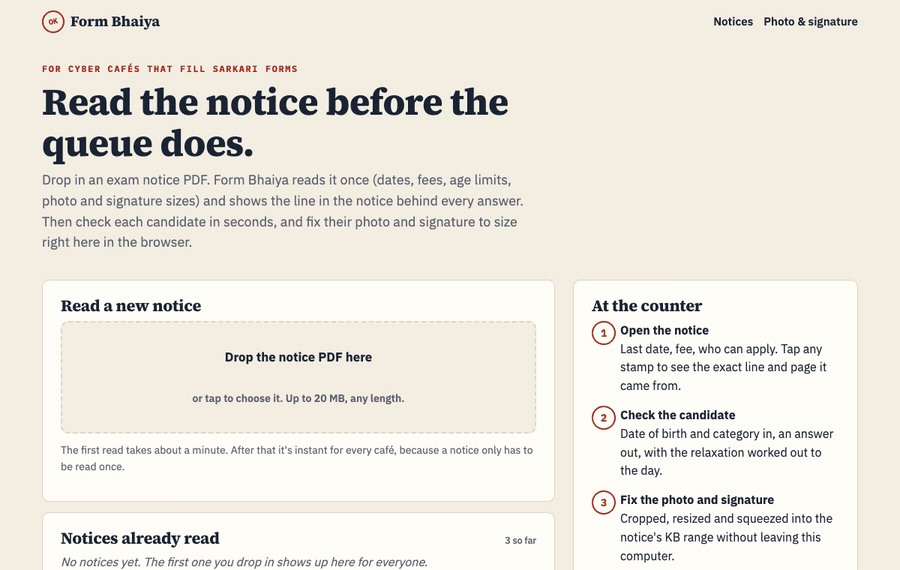
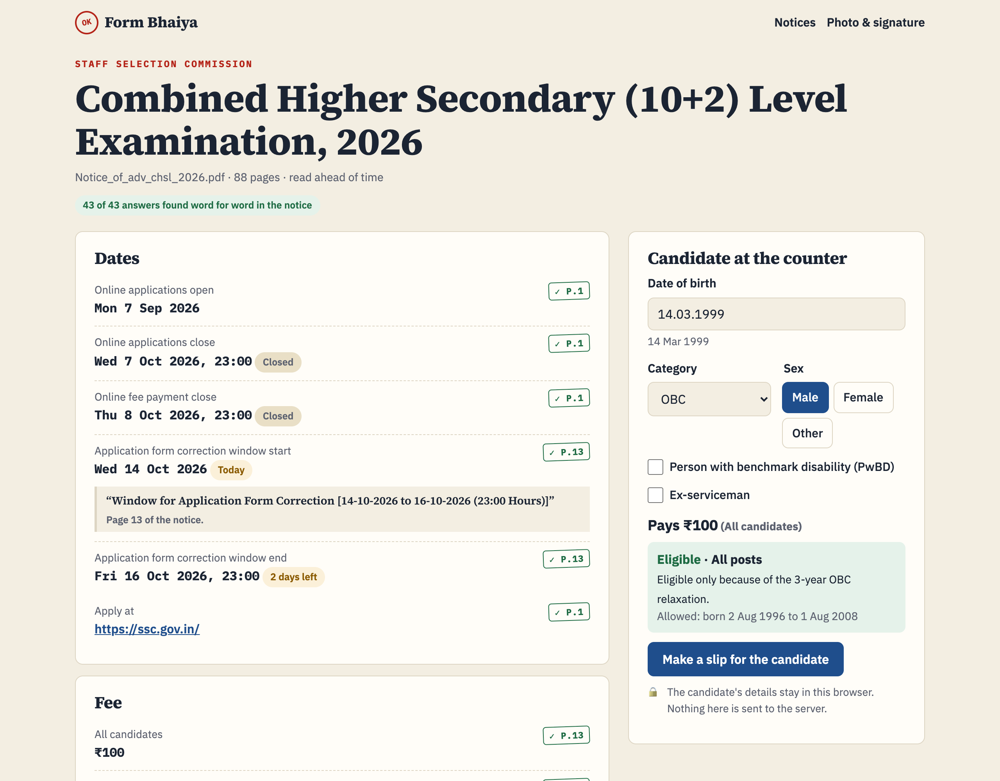
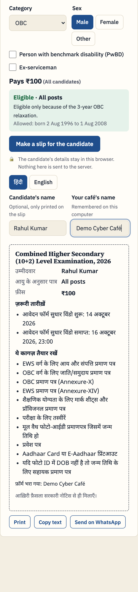

# Form Bhaiya

[](https://github.com/abjt01/form-bhaiya/actions/workflows/ci.yml)
[](https://render.com/deploy?repo=https://github.com/abjt01/form-bhaiya)

A second pair of eyes for the cyber café that fills government exam forms.

Across India, a lot of exam applications (SSC, UPSC, railways, state commissions) are filled in by the person at the local cyber café, the "form bhaiya", for a fee per form. Every exam comes with a 30 to 130 page notice, and every notice has its own last dates, fee exemptions, age windows, relaxations and photo and signature sizes. A wrong guess means a rejected form and a candidate who comes back angry.

Drop the notice PDF in. Form Bhaiya reads it once with open-weight models and shows the line in the notice behind every answer. Then the café checks each candidate at the counter, prints a Hindi slip for them to take home, and fixes their photo and signature to the exact size, all in the browser.

**Try it:** [form-bhaiya.onrender.com](https://form-bhaiya.onrender.com). It's on a free plan, so the first load after a quiet spell takes about half a minute.



<table>
  <tr>
    <td></td>
    <td></td>
  </tr>
</table>

## What a café gets

- **The notice, read once.** Dates with a countdown, fees and who's exempt, age limits as birth-date windows, the relaxation table, who can apply, photo and signature sizes, documents. A notice only needs reading once; after that it opens instantly for every café.
- **A stamp on every answer.** Tap it and you see the exact line from the notice and its page. Green means the quote was found in the PDF and every date and number in the answer is on that page. Red means it wasn't, and it says why.
- **The candidate check.** Date of birth, category, sex, PwBD, ex-serviceman. Out comes "Eligible", "Not eligible: born 1 day after the last allowed date", or "Eligible only because of the 3-year OBC relaxation", and the fee they pay. Relaxations that depend on service records are listed for a human to judge, not guessed.
- **A slip for the candidate**, in Hindi or English: what they're eligible for, the fee, the dates still ahead, the documents to keep ready. Print it, copy it, or send it on WhatsApp.
- **Photo and signature, fixed.** Crop, whiten the paper, trim to the ink, print the name and date under the photo if the notice wants it, and land the JPG inside the KB range. It all runs in the browser, so a candidate's photo never leaves the café's computer.

The library ships with three real notices already read: SSC CHSL 2026 (88 pages), SSC CGL 2026 (132 pages) and UPSC CDS II 2026 (35 pages). All 116 answers in them are stamped green.

## How a notice is read

A 132-page notice is about 55,000 tokens. Groq's free tier allows 8,000 tokens a minute per model, and it counts the reply's budget up front. So the app never sends the whole notice:

1. **Find the passages.** The PDF's text is split into overlapping windows and ranked with BM25 for each of five questions: dates and fees, age limits, uploads, who can apply, documents. Each question gets only its best passages, about 3,000 tokens. A passage that ends at a page break brings the start of the next page with it, because notices split table rows across pages.
2. **Ask three models at once.** The free limit is per model, so the questions run in three lanes: GPT-OSS 120B for dates, fees and age limits, GPT-OSS 20B for uploads and documents, Qwen 3.8 27B for who can apply. A notice takes about a minute.
3. **Check every answer against the PDF.** Each answer must come with a quote and a page. The quote has to be in the notice (exactly, or word for word allowing for line breaks), and every date and number in the answer has to appear on that page. Then a few rules in code: a live webcam photo has no file size, a "photo" whose only quote is about the signature is dropped, and relaxations that depend on service, employment or domicile go to a human.
4. **Do the arithmetic in code.** Ages, birth windows, relaxations and fees are plain functions with unit tests. The models read; they don't count.

## What the checks caught

These came up while building it, on the real notices:

| What a model said | What happened |
|---|---|
| The CDS live photo is "10 to 20 KB, 6 × 2 cm" | Those numbers aren't on that page. Stamped red: "The number 20 isn't on page 2." |
| The CGL live photo is "10 to 20 KB" | The numbers *are* on the page, in the signature sentence. Now an upload's quote has to mention the same kind of upload. |
| Some of the 12 relaxation rows, sometimes none | GPT-OSS 120B at medium reasoning effort sometimes spent its whole reply budget thinking, and Groq rejected the cut-off JSON. At low effort it returned all 12 rows every time I tried. |
| One age rule missing | The rule ran over a page break: "not later" / "Page 6 of 132" / "than 01-08-2008". Excerpts now carry over the start of the next page. |
| "Women candidates ... are exempted" | Quotes with "..." in them failed. Now each piece has to be found, on the same or the next page. |
| Birth dates inside "who can apply", with the wrong year | GPT-OSS 20B mixed them in. Qwen, asked the same question, kept to the qualifications and every answer verified. |

One more thing the code knows: SSC prints "age limit 18–27 years as on 01-08-2026" as "born not earlier than 02-08-1999". A plain reading of "not more than 27" would allow a year more. So printed birth dates always win, and a window the app has to work out from an age range is labelled as such.

## Why open models

- **The economics.** A café earns a small fee per form. Reading a notice costs nothing on Groq's free tier, and because a notice is read once and shared, the cost per form rounds to zero, even with a paid key.
- **Pick a model per question.** GPT-OSS 120B is the careful reader for the age table, Qwen 3.8 kept "who can apply" clean when GPT-OSS 20B didn't. Each is one setting.
- **Candidates' data never leaves the café.** The server only ever sees the public notice. The candidate check and the photo fixer run in the browser.
- **No lock-in.** The app speaks the OpenAI-compatible API, so a café or a chain of cafés can point it at Ollama or vLLM on their own machine by changing a base URL.

## Run it locally

```bash
npm install
cp .env.example .env   # add a free key from https://console.groq.com/keys
npm run dev            # http://localhost:4200
```

Without a key, the seeded notices, the candidate check, the slip and the photo fixer all work. Only reading new notices needs the key (the made-up notice in `test/fixtures` is read by a stand-in, so you can try the upload).

## Configuration

| Variable | Default | What it does |
|---|---|---|
| `GROQ_API_KEY` | none | Groq key |
| `READ_MODEL` | `openai/gpt-oss-120b` | Exam, dates, fees, age limits and relaxations |
| `READ_MODEL_SMALL` | `openai/gpt-oss-20b` | Photo and signature sizes, documents, Hindi for the slip |
| `READ_MODEL_SIDE` | `qwen/qwen3.8-27b` | Who can apply |
| `LLM_BASE_URL` | Groq | Any OpenAI-compatible server |
| `LLM_TOKENS_PER_MINUTE` | 8000 on Groq, off elsewhere | Pacing per model |
| `MONGODB_URI` | none | Keep notices in MongoDB instead of a JSON file |
| `DATA_DIR` | `./data` | Where the JSON file and page text live |

## Tests

```bash
npm run lint
npm test            # unit: dates, age windows, relaxations, fees, quote checks, passage search, image sizing
npm run build
npm run test:api    # the API against the built app
npm run test:e2e    # real Chrome: every screen at 320–1280px in light and dark, then the flows
```

API and browser tests run the built app without an AI key, on a spare port with a throwaway data folder. They upload `test/fixtures/demo-notice.pdf`, a made-up notice, which a stand-in reader answers with one deliberate mistake, so the red stamp gets tested too. The browser tests load every screen with the longest data the app has seen (and some it hasn't), check nothing overflows, then upload the notice, open stamps, check candidates to the day, make slips in both languages, and fix a signature and a photo, checking the downloaded files' pixels and bytes.

## CI and deploys

GitHub Actions runs lint and unit tests in one job, and the build plus API and browser tests in another. Render deploys from `render.yaml` only after CI passes, and Dependabot keeps dependencies current.

## Deploy your own (free)

Click **Deploy to Render** above and add your `GROQ_API_KEY`. Render's free tier sleeps when idle and wipes its disk; the three seeded notices come back on every start, and a free MongoDB Atlas cluster as `MONGODB_URI` keeps the ones you add.

## Layout

```
app/                  pages and API routes (Next.js App Router)
components/           NoticeRoom, Candidate (check and slip), Fixer (photo and signature), Stamp
lib/
  reader.js           the five questions, their prompts and the rules applied to answers
  search.js           passage windows and BM25
  verify.js           finding quotes in the PDF, checking dates and numbers
  eligibility.js      birth windows, relaxations, fees
  dates.js            dates the way notices write them
  imagespec.js        sizes, crops, paper cleaning, fitting a JPG into a KB range
  notices.js          library, reading lanes, per-notice locking, Hindi for the slip
  pdf.js, llm.js, store.js
seed/                 three real notices, already read
test/                 unit, API and browser tests, the demo notice
```

## Limitations

- Scanned notices (images with no text) are refused; there's no OCR.
- It reads what the notice says. Corrigenda and extensions published later need their own upload.
- The relaxation rules it applies are the ones that depend only on category, disability and sex. Anything involving service records is listed for a human.
- Always confirm against the official notice. That's what the stamps are for.

## License

[MIT](LICENSE)
